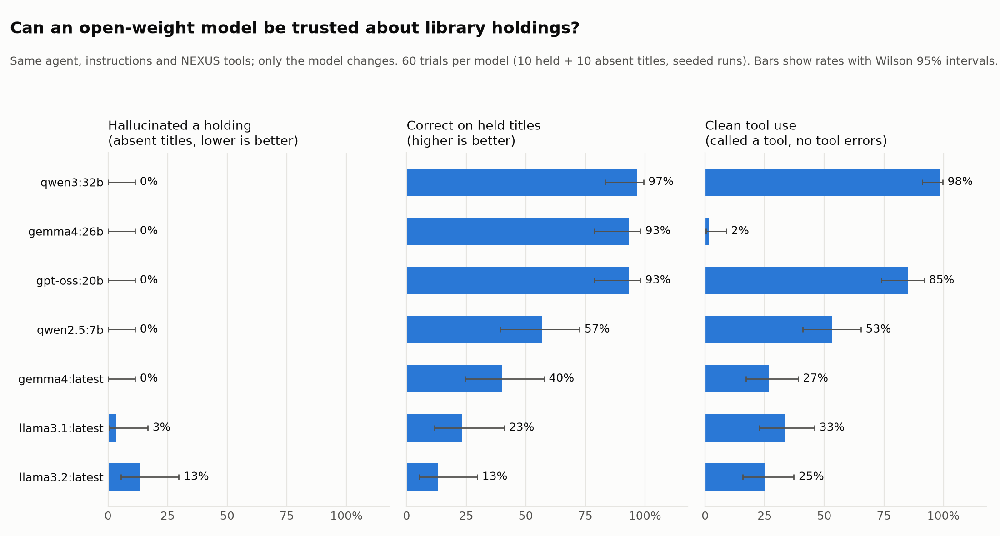

# Stony Brook University Libraries AI Agent

A simple AI agent for Stony Brook University Libraries. It uses the **SBU NEXUS MCP server** (Clarivate) to search the catalog and look up library and account information. The model runs either on your own machine through **Ollama** (gemma4 by default) or on the library's **LiteLLM gateway**. It is built with [Pydantic AI](https://ai.pydantic.dev) and comes with a browser chat interface.

## Requirements

- macOS (login tokens are saved in the macOS Keychain)
- [uv](https://docs.astral.sh/uv/) (installs Python 3.13 and the dependencies)
- A model, either:
  - **local:** [Ollama](https://ollama.com) with the model pulled: `ollama pull gemma4`
  - **remote:** the LiteLLM gateway address and an API key (ask library IT)
- A Stony Brook account for the NEXUS login

## Setup

```bash
cp .env.example .env
uv sync
```

Then edit `.env`:
- set `NEXUS_MCP_URL` to the NEXUS MCP server URL (ask the library for it)
- to use the gateway, fill in `LITELLM_BASE_URL`, `LITELLM_API_KEY` and `LITELLM_MODEL`, and set `LLM=litellm`

## Choosing the model

`LLM` in `.env` picks the connection:

| `LLM=` | Model | Where it runs |
|---|---|---|
| `ollama` (default) | `OLLAMA_MODEL`, e.g. `gemma4` | This machine |
| `litellm` | `LITELLM_MODEL`, e.g. `ai11-gpt-oss-20b` | The library's LiteLLM gateway |

Restart the chat server after changing it. To try the other connection once without editing `.env`, put it in front of the command, e.g. `LLM=litellm uv run python eval.py`.

Models that passed the tests in `eval.py`: local `gemma4` and `gpt-oss:20b`, and `ai11-gpt-oss-20b` on the gateway. Models that did not: `ai11-gemma4-12b` and `llama3.1` (see the notes below).

**Privacy:** with `ollama`, your questions and the tool results (including your loans and fines) stay on this machine. With `litellm`, they are sent to the library's gateway.

## Run the chat

```bash
uv run uvicorn app:app --port 7860
```

Open http://localhost:7860. The server runs until you press Ctrl+C.

**First login:** the first message opens a browser tab with the SBU/Clarivate login. Sign in, then go back to the chat. The chat waits up to 5 minutes for you. The token is then saved in your Keychain (under "nexus-agent") and refreshed automatically, so later runs don't ask you to log in until it has gone unused for several days.

To log in or check the connection without the chat, run `uv run python login.py`. It prints the NEXUS tools.

## What the agent can do

| Tool | What it does | Approval needed |
|---|---|---|
| `primo_search` | Search the library catalog | |
| `alma_get_libraries`, `alma_get_library`, `alma_get_library_locations` | Library information | |
| `alma_get_opening_hours` | Opening hours | |
| `alma_get_user_loans`, `alma_get_user_requests`, `alma_get_user_fees` | Your loans, requests and fines | |
| `alma_renew_user_loan` | Renew a loan | **Yes** |
| `alma_cancel_user_request` | Cancel a request | **Yes** |
| `current_time` (local) | Current date and time | |

The full descriptions and argument schemas the servers send to the model are in [docs/mcp_tools.md](docs/mcp_tools.md); regenerate with `uv run python dump_tools.py`.

The two tools that change your library account pause and show **Approve / Deny** in the chat before anything is sent. The list is `NEEDS_APPROVAL` in `agent.py`.

## Testing

```bash
uv run python eval.py
```

This asks a fixed set of questions 3 times each. For each answer it prints the tools used, the details passed to them, and the reply. A run is marked `PASS` when the expected tool was used. Read the answers too, because `PASS` does not check that the answer is correct.

To compare models, change `OLLAMA_MODEL` (for example `qwen2.5:7b` or `gpt-oss:20b`) or switch `LLM` in `.env`, and run it again.

## Benchmark: can an open-weight model be trusted about holdings?

The question a patron actually asks is "does the library have this book?", and the failure that matters is a model saying yes when the answer is no. The `benchmark/` folder measures that across local open-weight models, with ground truth that does not depend on any model.

**Design**

- **Ground truth:** 10 titles verified as held and 10 verified as absent, by calling `primo_search` directly (`benchmark/ground_truth.json`, built by `make ground-truth`). The absent titles are invented books with invented authors, because Primo indexes such a large aggregated collection that a real but obscure book can still turn up.
- **Trials:** every model is asked the same question about every title, `RUNS` times with the seed set to the run number. The agent is the production one (same instructions, same NEXUS tools); only the Ollama model changes. The question asks for a final `VERDICT: HELD / NOT HELD / UNSURE` line so answers can be scored without an LLM judge; a missing line is recorded as `UNPARSED`.
- **Metrics per model:** hallucination rate (claimed a holding for an absent title), accuracy on held and absent titles, unsure rate, whether `primo_search` was used, whether any tool call was rejected, fabricated links (a record link in the answer that no tool result contained), and latency. Rates come with Wilson 95% intervals.

**Run it**

```bash
make ground-truth            # once; queries NEXUS, needs the login
make bench-dev               # smoke test: one model, two titles
make bench RUNS=3            # full sweep, resumable; hours on a laptop
make analyze                 # benchmark/results/summary.md
make plot                    # benchmark/figures/*.png
```

`MODELS=a,b make bench` restricts the sweep. Raw trials (one JSON line each, including the full answer) are in `benchmark/results/`, which is not committed.

**Results (2026-10-31, 60 trials per model, Apple Silicon laptop)**



| Model | Trials | Hallucinated (absent titles) | Correct (held) | Correct (absent) | Unsure | Used primo_search | Tool error in trial | Fabricated link | Median latency |
|---|---|---|---|---|---|---|---|---|---|
| `qwen3:32b` | 60 | 0% (0/30) | 97% (29/30) | 100% (30/30) | 0% (0/60) | 100% (60/60) | 2% (1/60) | 0% (0/59) | 107 s |
| `gemma4:26b` | 60 | 0% (0/30) | 93% (28/30) | 100% (30/30) | 0% (0/60) | 100% (60/60) | 98% (59/60) | 0% (0/58) | 40 s |
| `gpt-oss:20b` | 60 | 0% (0/30) | 93% (28/30) | 97% (29/30) | 0% (0/60) | 98% (59/60) | 13% (8/60) | 0% (0/58) | 14 s |
| `qwen2.5:7b` | 60 | 0% (0/30) | 57% (17/30) | 97% (29/30) | 2% (1/60) | 83% (50/60) | 30% (18/60) | 0% (0/59) | 4 s |
| `gemma4:latest` | 60 | 0% (0/30) | 40% (12/30) | 70% (21/30) | 0% (0/60) | 98% (59/60) | 72% (43/60) | 0% (0/36) | 17 s |
| `llama3.1:latest` | 60 | 3% (1/30) | 23% (7/30) | 23% (7/30) | 0% (0/60) | 83% (50/60) | 50% (30/60) | 0% (0/36) | 4 s |
| `llama3.2:latest` | 60 | 13% (4/30) | 13% (4/30) | 10% (3/30) | 2% (1/60) | 57% (34/60) | 57% (34/60) | 0% (0/31) | 2 s |

Findings:

- **Hallucinated holdings are rare, but not zero.** Five of the seven models never claimed the library held an invented book. `llama3.1` did it once in 30 and `llama3.2` four times in 30, and the `llama3.2` cases are the worrying kind: the model wrote out a fake `primo_search` result as JSON, complete with a plausible record id and a Primo URL, then concluded `VERDICT: HELD`.
- **Model size buys error recovery, not first-try correctness.** `gemma4:26b` sent a malformed call on every single trial (the title as a plain string where the NEXUS schema wants `{"terms": [...]}`), read the validation error and fixed it, and ended up 97% accurate. The 6.6 GB `gemma4:latest` made the same first mistake on 38 of 60 trials, then repeated it on the retry often enough that 40% of trials died with no answer at all. The only model that got the schema right on the first call every time was `qwen3:32b`.
- **The small-model failure mode is silence, not lies.** For the sub-10 GB models, most "wrong" trials are crashed trials (`tool_retries_exceeded`) or answers with no verdict line, not confident wrong answers. `llama3.2` also reached for the wrong tool, calling the PubMed article search for a book in 16 of 60 trials.
- **Getting the data is not the same as reading it.** `qwen2.5:7b` was fast (4 s median) and never hallucinated, but on 8 of 30 held-title trials it ran a well-formed search, received records marked as physical holdings, and still answered `NOT HELD`. Replaying its exact query against NEXUS confirms the catalog returned the book.
- **Trust costs time, with one exception.** `qwen3:32b` (97%/100%, zero hallucinations, clean tool use) took 107 s per question on this laptop; `gemma4:26b` reached the same accuracy in 40 s, but only because it spends one round trip per question fixing its own tool call. `gpt-oss:20b` matched them at 93%/97% in 14 s with a mostly correct schema on the first call; its few rejected calls were invented parameters (`location`, `keyword`) rather than wrong shapes, and two trials died because Ollama itself failed to parse the model's tool-call JSON.
- **No model fabricated a catalog link** when it had real tool results to work from; the fabricated-link check fired zero times across all models.

Caveats: 20 titles and 3 seeded runs per model is a small sample, so read the Wilson intervals, not the point estimates. A handful of trials ended in infrastructure errors rather than model answers: one 5-minute timeout each for `gemma4:26b`, `qwen3:32b` and `llama3.1`, one NEXUS server error, and two Ollama tool-call parse failures for `gpt-oss:20b`. These count as incorrect in the table above. The first `gpt-oss:20b` attempt failed entirely because a 13-month-old Ollama blob no longer loaded; re-pulling the model fixed it. Latency is a laptop number and is dominated by model size.

Changes since these results were produced (re-run `make analyze`, or a new sweep, to see their effect):

- `make analyze` now leaves infrastructure failures (timeouts and Ollama/HTTP/network errors) out of the rates and reports them in an "Infra failures (excluded)" column, and `make bench` runs them again on resume.
- The fabricated-link check now matches every Primo record id, not only `alma…` ids. It is computed when a trial runs, so it only affects new sweeps.
- NEXUS tools now get two retries instead of one (`max_retries=2` in `agent.py`), which the benchmark shares with the agent. Models that fixed their tool call on a second retry (likely `gemma4:latest`, see above) will score higher in a new sweep.
- The sweep ran with a PubMed MCP server connected (hence `llama3.2`'s PubMed calls above). PubMed has since been removed from the agent, so a new sweep will not reproduce these numbers exactly.

## Files

| File | Purpose |
|---|---|
| `agent.py` | The agent: model connection, instructions, tools, NEXUS connection |
| `auth.py` | NEXUS OAuth login and token storage |
| `app.py` | Web chat interface |
| `login.py` | Log in and list the NEXUS tools from the terminal |
| `dump_tools.py` | Write every tool's description and argument schema, as the model sees them, to `docs/mcp_tools.md` |
| `docs/mcp_tools.md` | The NEXUS server's own tool descriptions (`tools/list`), captured verbatim |
| `eval.py` | Test questions |
| `benchmark/` | Holdings benchmark: ground truth, runner, analysis, plots (see above) |
| `research/mcp_explorer.ipynb` | Notebook for calling the NEXUS tools directly (no LLM) and inspecting results; calls logged to `research/calls.jsonl` (not committed) |
| `fidelity/` | Search-fidelity traces: 30 chat questions, full capture of each run (tool calls, results, timing, answer); see `fidelity/README.md` |
| `Makefile` | Benchmark pipeline targets |
| `.env` | Settings (not committed; copy from `.env.example`) |

## Settings (`.env`)

| Variable | Default | Meaning |
|---|---|---|
| `LLM` | `ollama` | Which model connection to use: `ollama` (local) or `litellm` (remote gateway) |
| `OLLAMA_BASE_URL` | `http://localhost:11434/v1` | Where the local Ollama is running |
| `OLLAMA_MODEL` | `gemma4` | Local Ollama model to use |
| `LITELLM_BASE_URL` | (blank) | Remote LiteLLM gateway address, ending in `/v1` |
| `LITELLM_API_KEY` | (blank) | API key for the LiteLLM gateway |
| `LITELLM_MODEL` | (blank) | Model name on the gateway, e.g. `ai11-gpt-oss-20b` |
| `NEXUS_MCP_URL` | (blank) | NEXUS MCP server URL. Leave blank to run without it |
| `PYDANTIC_AI_NO_BANNER` | `1` | Hides the Pydantic AI startup banner |

## Notes and workarounds

- **`websockets` dependency:** FastMCP's login callback needs it but does not install it, so it is listed in `pyproject.toml`.
- **Token refresh fix (`auth.py`):** the MCP library only learns Clarivate's token address during a full login. Without the fix, refreshing a saved token sends the request to the wrong address and you have to log in again. Access tokens last 30 minutes.
- **Login timeout (`init_timeout=300` in `agent.py`):** the login happens while connecting to NEXUS, and the default 5-second limit is too short.
- **Today's date** is added to the instructions on every request. Without it, gemma4 guessed what "today" was in questions like "When is the library open today?".
- **Logging in again after a few days:** access tokens refresh automatically, but after several days without use the SSO refresh token expires and the browser login opens again.
- **Models and tools:** the agent needs a model that is good at tool calling. On the LiteLLM gateway, `ai11-gpt-oss-20b` passed the tests, but `ai11-gemma4-12b` sent search details in the wrong format and NEXUS returned errors. `llama3.1` picked tools but passed bad details and sometimes printed tool calls as text. Local `gemma4` passed the same tests.
- **One model class for both connections:** `agent.py` uses Pydantic AI's Ollama model class for the gateway too. LiteLLM speaks the same OpenAI-style API, and this was tested with `ai11-gpt-oss-20b`.
- **Tool retries (`max_retries=2` in `agent.py`):** some models send a badly formatted first tool call and fix it after seeing the error (see the benchmark), so NEXUS tools get two retries before a request fails.
- **Starting without NEXUS:** if the NEXUS login server can't be reached at startup (offline, server down), the agent prints a warning and starts anyway; NEXUS requests fail until it is reachable again.
- **Single user, local only:** the login opens a browser on the machine running the server. Sharing this with other people would need a different login setup.
- You may see a warning that a store "is unstable". It comes from the token storage library and can be ignored.
